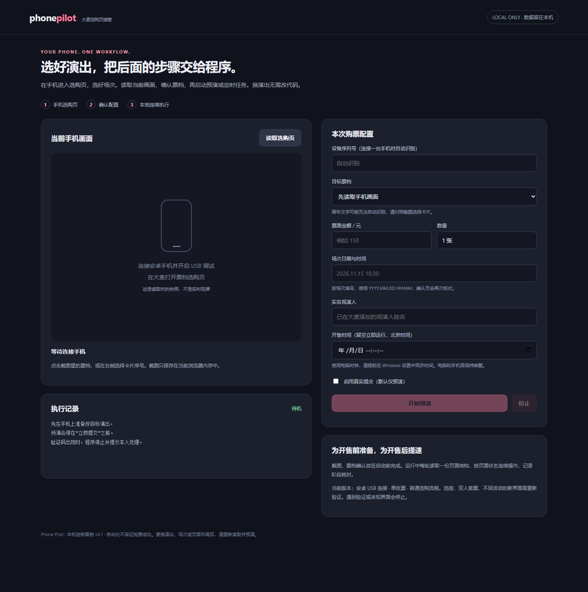

# Phone Pilot — 大麦选购页接管

在安卓手机上手动打开目标演出的选购页、选好场次，再由本机程序接管票档、观演人和确认流程。换歌手或场次时重新读取页面和填写配置，不需要修改 Python 代码。



## 当前状态

这是 v0.1 开发预览版，不承诺抢票成功。当前支持 **安卓 USB 连接、普通选购流程、单张票**。不支持选座、双人套票、多个观演人及所有大麦页面变体。

早期专场脚本已在一台 Android 17 / 大麦 9.0.37 手机上分步到达确认购买页并选中观演人；确认页准备检查曾测得约 0.373 秒。这个数字仅代表最后一段，**不是完整抢票耗时或成功率**。通用面板与状态机在手机拔下后开发，已做离线测试，尚待完整真机回归。真实订单提交未做实测。

## 安装和打开

1. 安装 Python 3.10–3.13，安装时选中 Add Python to PATH。
2. 安装 Android SDK Platform Tools，让 `adb devices` 可以看到手机。手机开启 USB 调试并授权电脑；部分小米系统还需“USB 调试（安全设置）”。不要求 root。
3. Windows 双击 `setup.cmd` 安装独立环境和依赖。
4. 双击 `start.cmd`，在浏览器打开 **http://127.0.0.1:8765**。

其他系统可以执行：

```sh
python -m venv .venv
# 激活虚拟环境后
python -m pip install -r requirements.txt
python server.py
```

## 每次使用

1. 在手机登录大麦，提前添加实名观演人。
2. 手动进入目标演出的 **票档选购页**，选好场次。能提前预选票档时也先选好。
3. 在电脑点击“读取选购页”。截图是读取时的快照，不是实时投屏。
4. 点击截图中的目标票档卡片，填写票面金额、场次日期时间、观演人姓名。场次格式是 `YYYY.MM.DD HH:MM`，以确认页的场次时间为准。
5. 先点“开始预演”：程序校验页面、选票、进入确认页、勾选指定观演人，然后停在“立即提交”前。
6. 若要正式运行，手动勾选真实提交并输入确认词。每个任务只尝试点击一次“立即提交”；结果不确定时请在大麦核对订单，不会自动重复下单。付款由本人完成。
7. 可填写未来开售时间；按北京时间解释，使用电脑系统时钟。提前同步 Windows 时间并保持电脑、手机唤醒。等待过程中可以点“停止”。

更换演出、场次、分辨率或票档布局后，必须重新读取当前页面。程序保存上一轮姓名、金额和日期方便填写，但它们不会自动保证适用于新演出，需要核对。

验证码或访问异常会使程序停止。请本人完成验证，再重新读取页面启动；不要连续重跑来尝试绕过验证。账号限制和服务端库存不会因为本地自动化而消失。

## 性能设计

- 开售前完成页面读取、卡片确认和配置，不在开售后搜索歌手。
- 运行中每轮只读取一份界面树，同一份快照完成匹配、金额和观演人检查。
- 运行期间临时降低 UIAutomator 的空闲等待时间，退出后恢复。
- 使用单调时钟等待，避免倒计时期间系统时钟调整造成跳动；电脑时钟误差仍影响启动时刻。
- 按状态执行：票档 → 确认页 → 观演人 → 提交前/提交一次。页面没推进时有限等待，超时停止，不盲目连点。
- `local/logs/` 记录每轮检查与总耗时。服务器处理、USB 延迟、验证码、网络和界面变化都会影响耗时。

目前保留每轮前台检查和金额校验；还没有用多设备并发或高频接口请求来“加速”。普通选购流程的未选票档文字如果由 Canvas 绘制，会通过启动前的截图由你确认卡片；选中后用原生金额字段再次核对。

## 本地数据与发布

- 服务只监听 `127.0.0.1`，修改操作校验随机令牌及请求来源。
- 无需提供大麦密码、Cookie、身份证号码或 GitHub token。
- 姓名和上一轮配置存在 `local/profile.json`；运行日志存在 `local/logs/`。`local/` 已忽略，不要将其上传公开仓库。
- 读取手机时的截图和页面结构暂存在进程/浏览器内存中；刷新或退出后重新读取。
- 仓库里的预览图为未连接设备的空白面板，不含真实观演人或手机截图。

## 开发验证

```sh
python -m unittest -v test_pilot
```

测试覆盖选错金额/场次/观演人、布局变化、数量限制、验证页、来源与令牌校验、整条模拟流程、取消，以及真实模式只提交一次。模拟测试不能代替开售实战。

源码参考与设计取舍见 [SOURCE_REVIEW.md](SOURCE_REVIEW.md)。本项目使用 MIT 许可证，与大麦及参考项目无隶属关系。
